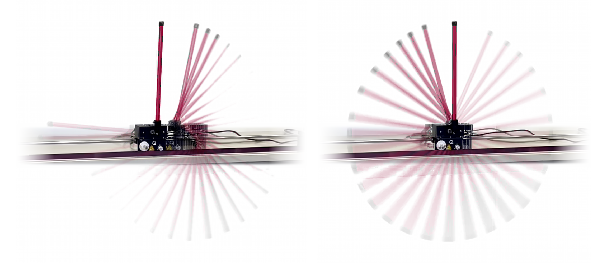
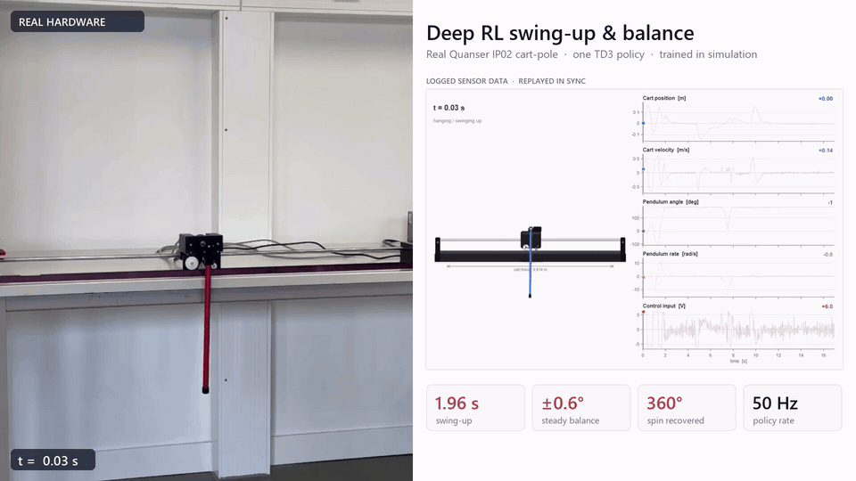
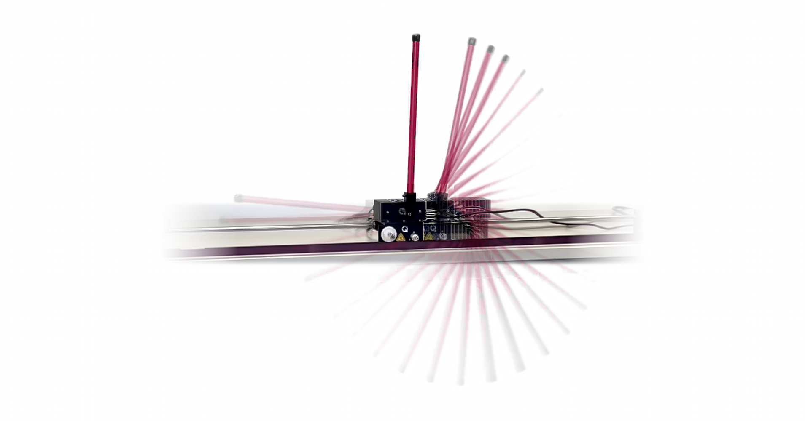
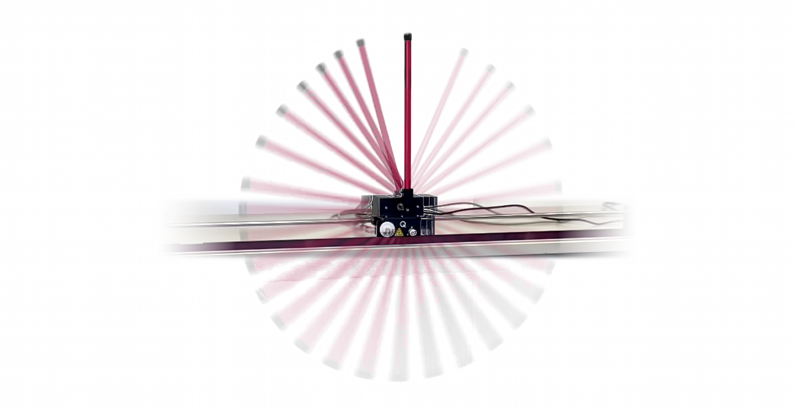
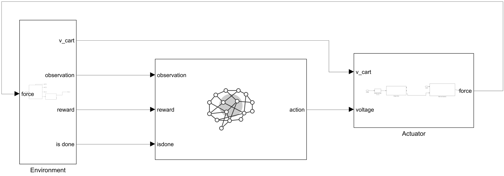
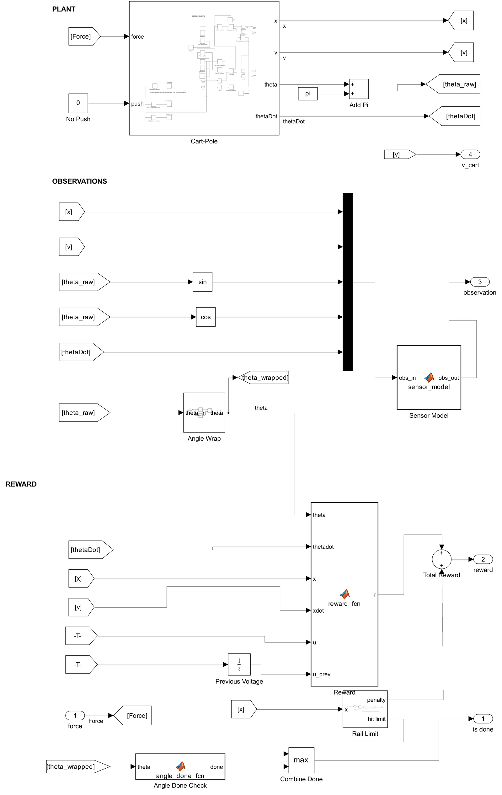
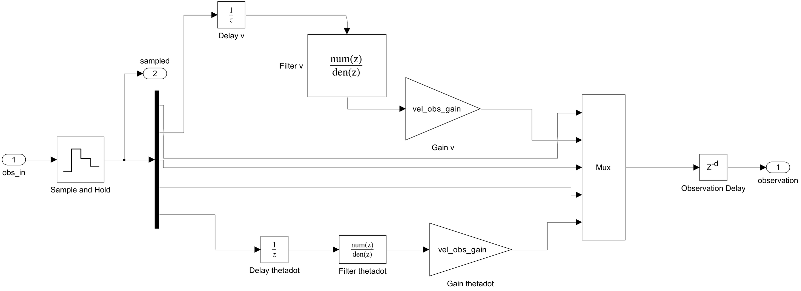
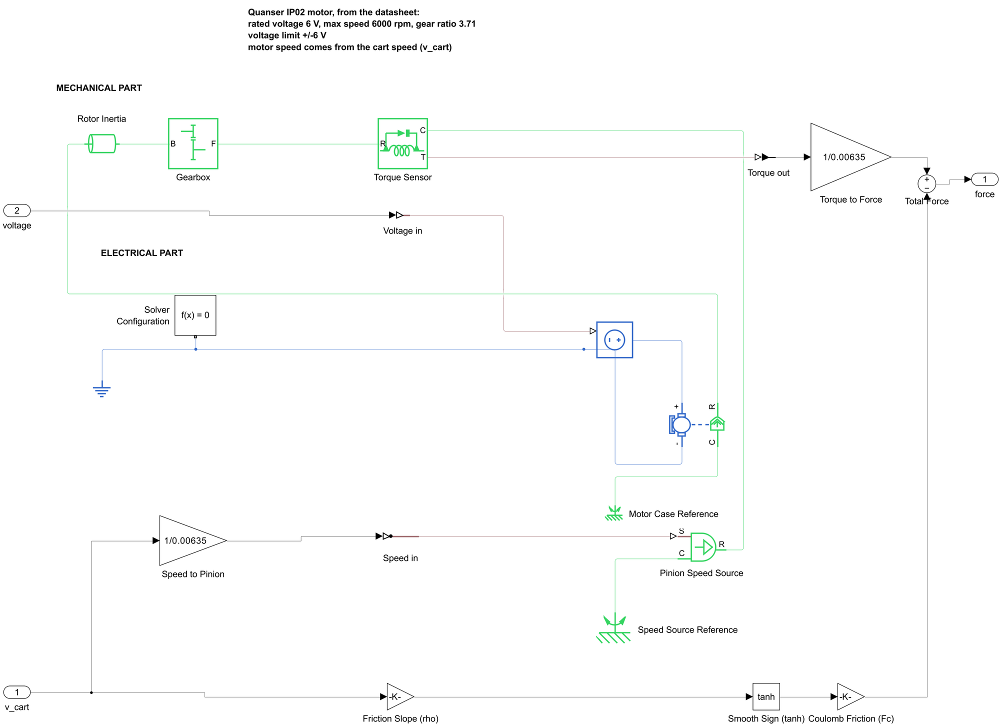

# Deep RL swing-up and balance on a real inverted pendulum



I trained a TD3 agent in Simulink and Simscape. Then I ran it on a real Quanser IP02 cart-pole.
A common way is to use two controllers: an energy controller for the swing-up and LQR for the
balance. Here one small neural network does both. It can also catch the pendulum after a hard
push that turns it all the way round. Every 20 ms, the network reads five values and sets the
motor voltage.



Full video (1080p, 60 fps): [media/real_vs_replay_1080p60.mp4](media/real_vs_replay_1080p60.mp4)

On the left you see my phone video of the rig. On the right you see the sensor data from the
same run. The rig recorded this data, and I play it back at the same time as the video. So you
can see the cart position, the pendulum angle and the motor voltage at every moment.

## Results on the real rig

All numbers come from the data of the run in the video. The run is 16.9 s long, with 50 samples
per second.

| What | Value |
|---|---|
| Swing-up time (from hanging down to less than 10° from the top) | 1.96 s |
| How far the cart moves during the swing-up | 0.25 m |
| Time at the ±6 V limit during the swing-up | 80 % |
| Fastest pendulum speed during the swing-up | 12.6 rad/s |
| Balance error in the last 5.4 s | 0.27° RMS, 0.53° max |
| Hard push that turns the pendulum a full 360° | caught and balanced again |
| Two small pushes (about 10°) | back within 8° after 0.14 s or less |

| Swing-up | Catch after a full turn |
|---|---|
|  |  |

## Simulink model



The model has three main blocks. The Environment block is on the left. It has the cart-pole
(Simscape Multibody), a sensor model, filters for the measured values, and the reward. The agent
in the middle sends a voltage to the Actuator block on the right. There, the voltage gets a
gain, an offset, a dead zone and a ±6 V limit. Then it goes into a Simscape model of the DC
motor. The motor uses this voltage and the cart speed to make a force on the cart.

<details>
<summary>Inside the blocks</summary>

Plant: the cart-pole, the values the agent sees, and the reward:



Observation pipeline: filters and delays for the speeds:



Motor and gearbox:



</details>

## How it works

The agent gets five values:

- cart position x
- cart speed ẋ
- sin θ and cos θ of the pendulum angle
- pendulum speed θ̇

θ = 0 means the pendulum hangs down. θ = π means it stands up. The agent outputs a motor voltage
between -6 V and +6 V.

The real rig gets its speeds from the encoders. It filters them, so they arrive a little late.
The model does the same: both speeds go through a first-order low-pass filter and a delay of
one sample.

I used TD3 with one actor network and two critic networks. Each network has two hidden layers
with 400 and 300 neurons. The actor ends with tanh, and the output is scaled to ±6 V. Other
settings: replay buffer of 2 million steps, batch size 256 and τ = 0.005. The policy and the
target networks update every second step.

I measured some plant values on the real rig. The effective cart mass (cart plus the turning
motor parts) is 1.025 kg. The motor voltage gain is 0.8, and the voltage offset is -0.18 V. I set
the Coulomb friction to 1.8 N. The model also has the measured sensor noise, and the encoders
have 4096 counts per turn.

The reward is high when the pendulum is up and the cart is near the middle. An energy part of
the reward helps with the swing-up. It gives a penalty when the pendulum has too much or too
little energy to reach the top. This teaches the agent to pump energy into the swing. Most other
penalties start only when the pendulum is less than 60° from the top. Two examples are the
penalties for the cart position and for fast voltage changes. They get stronger near the top. Lower down,
they would stop the cart from building up the swing.

## Training stages

Training has five stages and about 6,800 episodes:

| Stage | Start position | Episode length | Episodes |
|---|---|---|---|
| 1. Balance | near the top (± 25°), small kicks | 6 s | 1500 |
| 2. Pump energy | 45° to 140° from the top | 12 s | 1500 |
| 3. Swing-up | hanging down (± 15°) | 12 s | 2000 |
| 4. Mixed tasks | swing-up, balance and pushes, random plant | 12 s | 1500 |
| 5. Smoother balance | top only, bigger penalties for fast changes | 8 s | 300 |

In stage 4, each episode gets new random plant values. Sensor noise is also on.

| Parameter | Range |
|---|---|
| Coulomb friction | 1 to 3 N |
| Viscous loss | 0 to 1.5 |
| Motor dead zone | 0 to 1 V |
| Voltage gain | 0.72 to 0.88 |
| Voltage offset | -0.27 to -0.10 V |
| Gain on the measured speeds | 0.85 to 1.15 |

## The speed problem

My first agents balanced well on the real rig, but they could not swing up. They got stuck about
halfway. In simulation everything worked, so it took me some time to find the reason. In the end,
the recorded data showed it. The rig measured the speeds about 1.42 times too high, and the agent
never saw values like that in training. I changed the speed filter on the rig to 77s/(s+110).
Now the rig measures the real speed. The agent in this repository was trained with the real
speeds. It worked on the rig with no extra training on the hardware.

## Files

```
training/   train_InvertedPendulum_SwingUpBalance_RL.m   training script (stages 1 to 5 and export)
            InvertedPendulum_SwingUpBalance_RL.slx       Simulink model (agent, plant and motor)
            scaleToVoltage.m                             output layer of the actor
policy/     swingup_policy.mat                           trained policy that runs on the rig
media/      pictures and video of the hardware run, screenshots of the model
```

## Running the training

You need MATLAB R2025b with these toolboxes: Simulink, Reinforcement Learning Toolbox, Deep
Learning Toolbox, Simscape, Simscape Multibody, Simscape Electrical and Simscape Driveline. A GPU
makes training faster, but you do not need one.

```matlab
cd training
setenv('QUICK_TEST','1')   % optional: quick test with about 1 % of the episodes
run('train_InvertedPendulum_SwingUpBalance_RL.m')
```

The script saves everything in `training/run/`:

- the agent after each stage (`stage1_agent.mat` to `stage5_agent.mat`)
- checkpoints
- the policy file `swingup_policy.mat`

When the model loads, MATLAB may show a warning: the code generation target `TwinCatGrt.tlc` is
missing. You can ignore it for simulation and training.

On Windows, use a short folder path, for example `C:\rl\`. Simulink makes build files with long
names, and Windows allows only 260 characters in a path.

I tested a fresh copy of this repository with the quick test. All five stages and the export ran
with no errors. It took about 7 minutes on my PC with a GPU.

I cleaned up the script and the model before I published them. The training settings are the
same as in the run that made the policy in `policy/`. I only changed names and the export. The
export no longer needs a template file.

## License

MIT, see [LICENSE](LICENSE).
